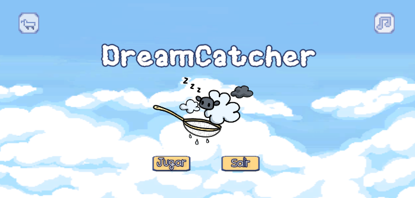
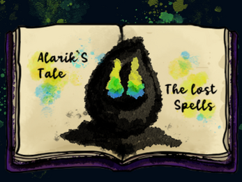
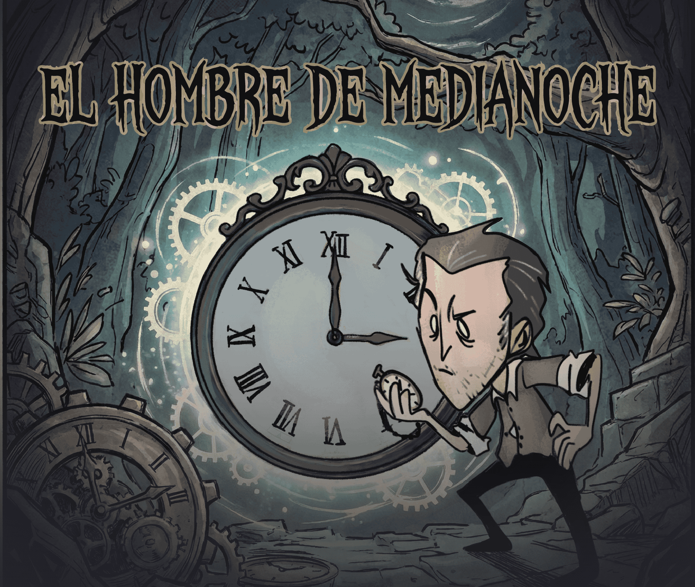
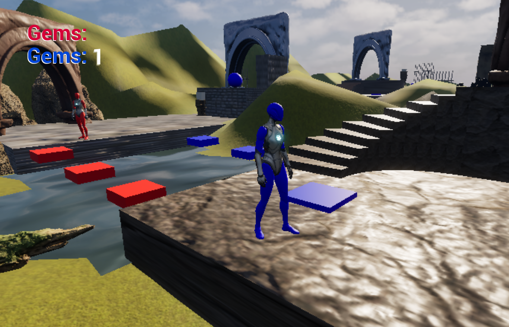
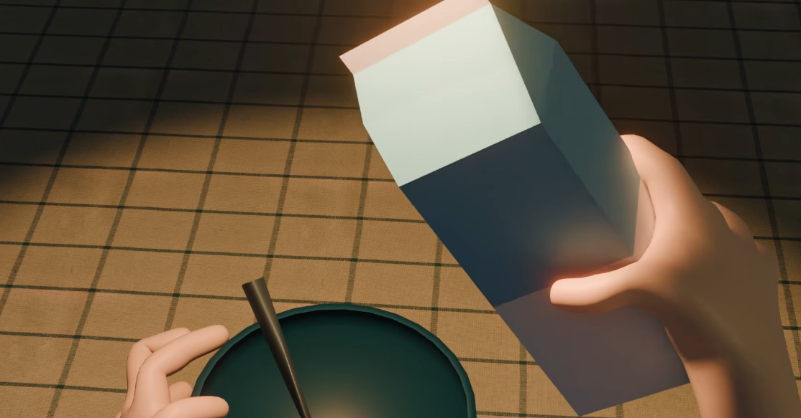

# Proyectos de videojuegos

Una selección de proyectos de desarrollo de videojuegos,
programación y experiencias interactivas.

---

## Proyecto 01 — Dreamcatcher

**Descripción:**

Breve descripción del videojuego, su concepto, objetivo y características principales.

**Tecnologías:** Unity, C#.

**Rol:** Diseño y programación.

---

## Proyecto 02 — El hombre de medianoche

**Descripción:**

Descripción del proyecto y de las funcionalidades implementadas.

**Tecnologías:** Unity, C#.

**Rol:** Programación y desarrollo.

---

## Proyecto 03 — Alarik´s Tale

**Descripción:**

Descripción del proyecto y de las funcionalidades implementadas.

**Tecnologías:** Unity, C#.

**Rol:** Diseño y desarrollo.

---

## Proyecto 04 — Unreal explorers (Fire boy & Water girl simulation)

**Descripción:**

Descripción del proyecto y de las funcionalidades implementadas.

**Tecnologías:** Unreal Engine, Blueprints Visual Scripting.

**Rol:** Programación, diseño y desarrollo.

---

## Proyecto 05 — Montón de Significado (Cortometraje — Producción Digital 3D)

**Descripción:**

Descripción del proyecto y de las funcionalidades implementadas.

**Tecnologías:** Blender.

**Rol:** Modelado, animación y edición.

---

[Volver al inicio](index.md)
